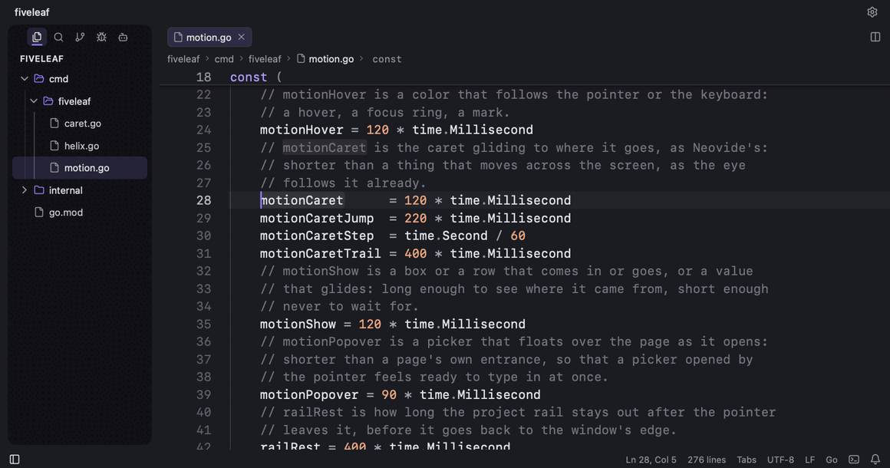
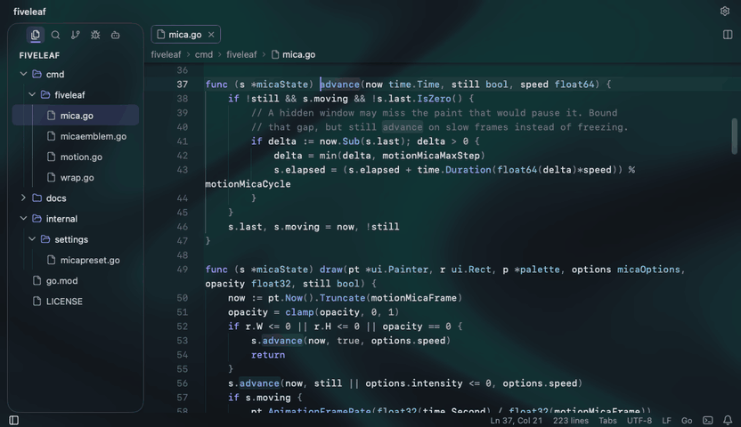
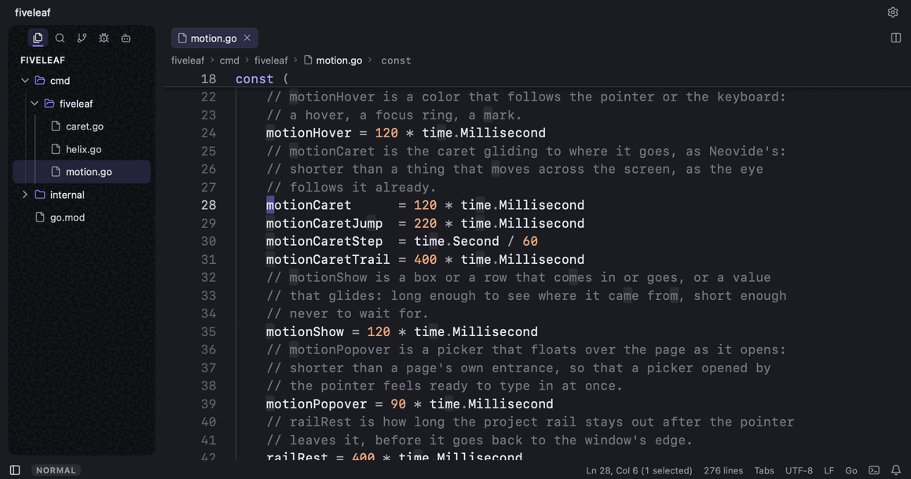
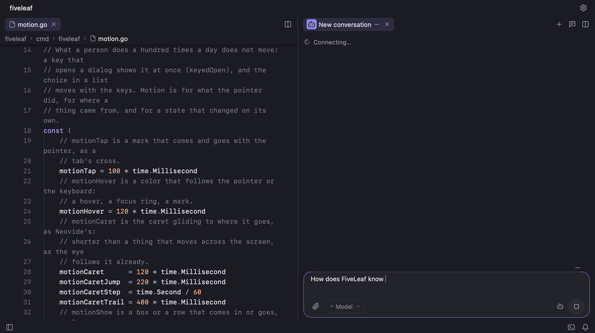
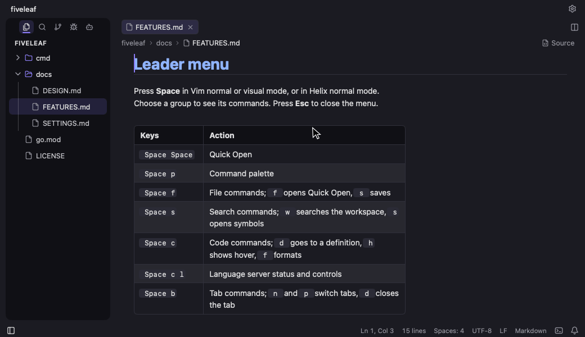

<p align="center">
  
</p>

<h1 align="center">FiveLeaf</h1>

<p align="center">A native code editor built with Go and MyGo. Work with code, Markdown, Git diffs, terminals and AI agents in the same workspace.</p>

<p align="center">English · <a href="README.zh-CN.md">简体中文</a> · <a href="#quick-start">Quick start</a></p>

## Quick start

Building from source requires Go 1.27.3 or later. FiveLeaf runs on macOS 13 or later and uses GTK 3 on Linux. Run this from the repository root to open FiveLeaf in its own source tree.

```sh
go run ./cmd/fiveleaf .
```

Press `⌘P` on macOS or `Ctrl+P` on Windows and Linux. Search for `motion.go` to open the file in the first demo. In Quick Open, `:42` goes to line 42, `@` lists the current file's symbols, and `>` searches commands by name. [Quick Open](docs/FEATURES.md#quick-open)

## Smooth caret

Click a different line, navigate with the keyboard, or drag to select text. The caret glides toward the target and its trail catches up when it stops. The selection updates as you drag. The same motion follows counted Vim and Helix jumps in source files and Markdown Live Preview.



**Settings → Editor → Smooth Caret** is on by default and follows the system's Reduce Motion setting. [Editor settings](docs/SETTINGS.md#the-rest)

## Mica material

Enable **Settings → Appearance → Material → Mica Material** to add frosted surfaces and moving light to your current light or dark theme. Preview changes to frost, hue, intensity and speed, or turn off **Animated Mica Background** for a still backdrop. **Import…** and **Export…** let you share these settings as JSON.



Open an Agent chat or a roundtable conversation to see the five-leaf particle emblem form. Move the pointer across it and nearby particles scatter, then gather again. [Mica settings](docs/SETTINGS.md#the-rest)

## Native Helix keys

Choose **View → Helix Keys** to use Helix's core selection-first commands. Each tab starts in normal mode with one character selected. Pick a word with `gw`, press `c` to replace the selection, then press `Esc` to return to normal mode.



| Keys | Action |
| --- | --- |
| `h j k l`, `w b e` | Move by character, line or word. Prefix a motion with a count, as in `5j`. |
| `gw` | Type a visible word's two-letter label to select it. |
| `c`, `y`, `p`, `u` | Change, yank, paste or undo. |
| `gd` | Jump to a definition with the file's language server. |
| `Space`, `Space Space`, `Space p` | Open the Leader menu, Quick Open or the command palette. |

**View → Vim Mode** switches to Vim's motions, operators, text objects, registers and macros. Both modes use FiveLeaf's Leader menu for file, split, search and Git commands. [Helix keys](docs/FEATURES.md#helix-keys) · [Vim mode](docs/FEATURES.md#vim-mode) · [Leader menu](docs/FEATURES.md#leader-menu)

## AI in the workspace

### Chat beside your code

FiveLeaf connects to Agent Client Protocol (ACP) adapters and can also launch registered command-line agents. Each Agent manages its own account, models and tools.

1. Open a local project and install and enable a Codex, Claude Code, Pi or other Agent plugin in **Settings → Plugins**. If the Agent requires sign-in, use its CLI or sign-in prompt. Then open **Agent Sessions → New Chat**. Chats can sit in tabs or splits, each with its own draft and conversation.
2. Type `@` to attach `cmd/fiveleaf/caret.go`, then ask “How does FiveLeaf know the caret is still gliding?” You can also right-click code and choose **Add Selection to Agent** to put the text and line numbers in the draft before sending.
3. Follow the streaming reply and tool calls, and answer permission requests in the chat. If the Agent reports a changed file, click it to inspect the before-and-after diff. Use **Git → Review Workspace Changes** to review the current working tree. [Start a chat](docs/AGENTS-ACP.md#start-a-chat) · [Review changes](docs/AGENTS-ACP.md#review-changes)



*The demo uses a local scripted ACP adapter and a copy of FiveLeaf's source.*

### Check a change with a roundtable

Open **Agent Sessions → Roundtable**, then choose **New roundtable → Use a template… → Implementation verification** to prefill an implementer, a test engineer and a reviewer. For a change to the caret, add a brief such as “Verify that keyboard navigation works with Reduce Motion enabled.” An AI or human chair can direct the discussion.

Pin requirements in **Group memory**. Open **Execution Graph** to inspect assignments, tool activity and handoffs. From a conclusion, choose **Continue with an Agent…** to prepare a follow-up draft. Reopen saved meetings from the sidebar or export their transcripts as Markdown. [Roundtables](docs/AGENTS-ACP.md#hold-a-roundtable)

### Request completions and commit drafts

In **Settings → Agent → Copilot**, pick a registered Agent and optionally a model. Run **Selection → Suggest Text with Copilot** for a completion at the caret, or enable inline suggestions and use `Tab` to accept and `Esc` to dismiss. After staging a change, choose **Git → Draft Commit Message with Copilot** to fill in an editable draft from the diff. [Copilot settings](docs/SETTINGS.md#copilot)

## Markdown you can edit in place

Markdown opens in editable Live Preview by default. Right-click to format text or insert a table. Click a cell to edit it directly, press `Tab` to move across columns, or press `Enter` to move down. The table menu can add or remove rows and columns. Click a Mermaid diagram or a LaTeX formula to edit its definition.



Use **Source** or **Preview** beside the file path to switch views. Split the editor to keep the source and preview side by side. The panes share the text and undo history, and each keeps its reading position. [Markdown and previews](docs/FEATURES.md#image-viewer)

## Everyday work in the editor

### Find and change code

Split a pane in any direction and drag tabs between panes. Each can have its own scroll position and tabs. Use **Edit → Replace in Files** to scope a change to patterns such as `*.go`, preview the replacements, and apply them one match or one file at a time. [Splits](docs/FEATURES.md#columns) · [Search and replace](docs/FEATURES.md#search)

### Navigate and debug

Install a language-server plugin and its server on the workspace machine. With `lsp-go` and `gopls`, for example, you can see diagnostics, complete identifiers and use `F12` to jump to a definition. With a debugger plugin configured, press `F9` to set a breakpoint and `F5` to start **Run and Debug**, then inspect the call stack and variables. [Language servers](docs/LANGUAGE-SERVERS.md) · [Debug adapters](docs/PLUGINS.md#debug-adapters)

### Review Git changes and compare files

Read changes inline or side by side, stage a hunk, or open a commit from the graph to see its diff. Select changed lines and press `c` to leave a review comment. The review toolbar can copy your notes with the surrounding code. For two local files, choose **File → Compare Two Files…** and use the arrows on a hunk to copy it to either side. [Diffs](docs/FEATURES.md#diffs) · [Review comments](docs/FEATURES.md#review-comments)

### Run tasks and work over SSH

Open a Ghostty-powered terminal in a panel or a tab. Put project build or test commands in `.fiveleaf/tasks.json`, then run them from **View → Tasks → Run Task…**. A failed task keeps its output and offers a rerun. On macOS and Linux, an SSH folder gives you remote browsing, search, Git and a shell on the host. [Tasks](docs/TASKS.md) · [Remote SSH](docs/FEATURES.md#remote-ssh)

### Add tools and customize the editor

Install a JSON, timestamp, Base64 or URL tool under **Settings → Plugins → Tools** and open it by name from the command palette. Each tool opens in an editor tab and keeps its input when you switch tabs. Plugins also provide formatters, themes, file icons and keymaps. [Toolbox](docs/PLUGINS.md#toolbox) · [Settings and shortcuts](docs/SETTINGS.md)

## Build and command line

Run `go tool mygo build` to package FiveLeaf for your machine. On macOS, open `build/darwin-arm64/FiveLeaf.app` on Apple Silicon or `build/darwin-amd64/FiveLeaf.app` on Intel. After copying it to Applications, choose **File → Install 'ff' Command**. From a terminal, `ff .` opens the current folder, `ff -g cmd/fiveleaf/caret.go:101` jumps to a line, and `ff -d` followed by two paths opens a comparison. [Command-line reference](docs/FEATURES.md#the-ff-command)

To reuse Mayoi's settings, point `FIVELEAF_DATA_DIR` at its data directory. FiveLeaf accepts `MAYOI_DATA_DIR` as a fallback and reads existing `.mayoi/settings.json` project settings. [Settings files](docs/SETTINGS.md#where-the-files-are)

[Feature guide](docs/FEATURES.md) · [Architecture](docs/ARCHITECTURE.md) · [Contributing and releases](CONTRIBUTING.md)

## License and acknowledgments

FiveLeaf is based on [Mayoi](https://github.com/sorrycc/Mayoi) and continues its native Go and MyGo editor architecture. The packaged app includes Mayoi's original copyright notice and [MIT license](LICENSE).

We liked the way light drifts behind the frosted glass in [Aqua](https://github.com/afrel1024/dsh-client-ui-aqua-unofficial), so we recreated it in [MyGo](https://github.com/egoist/mygo) as FiveLeaf's Mica material. The editor, tabs and sidebar share one moving backdrop.
