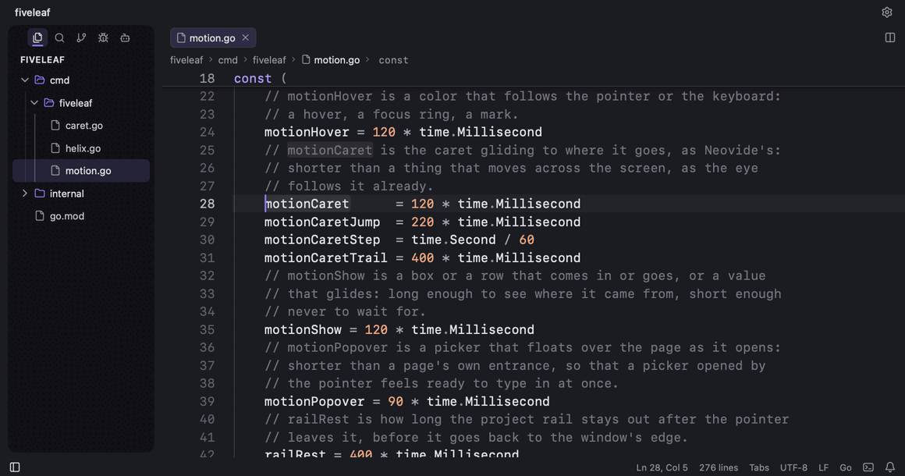
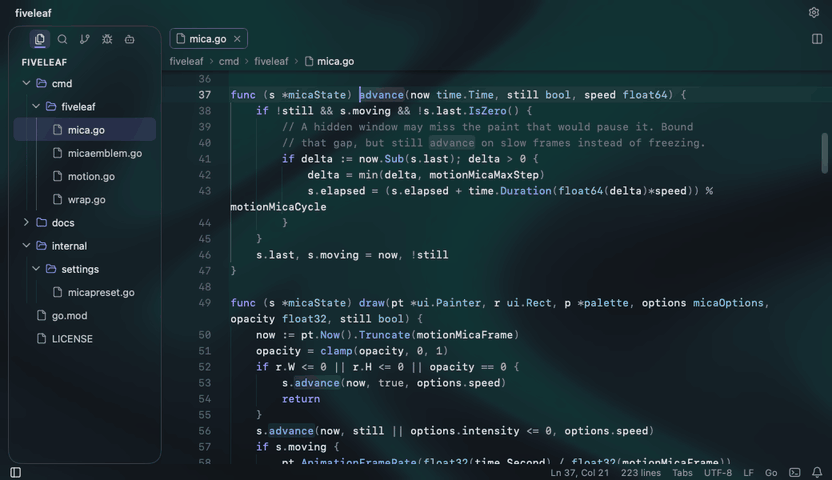
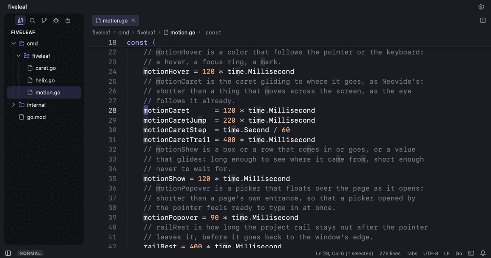
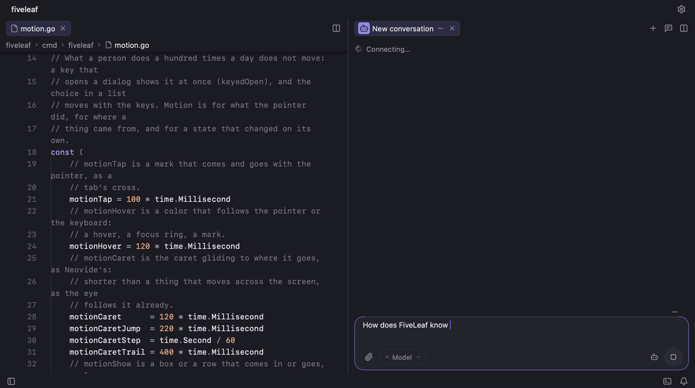
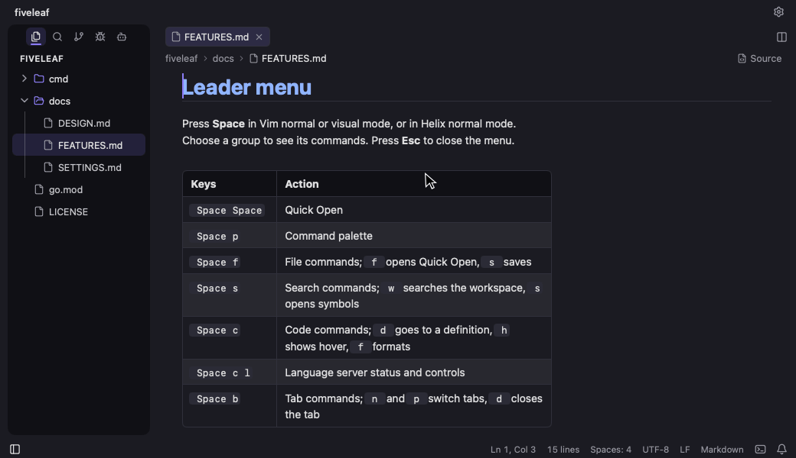

<p align="center">
  
</p>

<h1 align="center">FiveLeaf</h1>

<p align="center">用 Go 和 MyGo 构建的原生代码编辑器。在同一个工作区里写代码和 Markdown、看 Git 改动、打开终端和 Agent 会话。</p>

<p align="center"><a href="README.md">English</a> · 简体中文 · <a href="#快速上手">快速上手</a></p>

## 快速上手

需要 Go 1.27.3 或更新版本。macOS 需要 13 或更新版本，Linux 需要 GTK 3。在仓库根目录运行下面的命令，就能用 FiveLeaf 打开它自己的源码。

```sh
go run ./cmd/fiveleaf .
```

在 macOS 上按 `⌘P`，在 Windows 和 Linux 上按 `Ctrl+P`，搜索 `motion.go` 就能打开第一段演示里的文件。快速打开也支持输入 `:42` 跳到第 42 行、输入 `@` 查找当前文件的符号、输入 `>` 按名称查找命令。[快速打开](docs/FEATURES.zh-CN.md#quick-open)

## 滑动光标

点击另一行、用键盘跳转或拖动选区时，光标会滑向目标位置，停下时拖尾逐渐收拢。拖动时选区立即更新。源码和 Markdown 实时预览都支持这套动效，Vim 和 Helix 带次数的移动指令也能触发。



**设置 → 编辑器 → 平滑光标** 默认开启，并跟随系统的「减少动态效果」设置。[编辑器设置](docs/SETTINGS.zh-CN.md#the-rest)

## 云母材质

在 **设置 → 外观 → 材质 → 云母材质** 中开启，为当前浅色或深色主题叠加磨砂质感和流动光影。调整磨砂浓度、色相、光影强度和流动速度时可以预览效果。关闭 **动态云母背景** 可保留静态材质，也可以用 **导入…** 和 **导出…** 分享 JSON 配置。



打开 Agent 会话或圆桌对话，可以看到粒子聚成五叶图案。移动指针时，附近的粒子散开，然后慢慢聚回去。[云母设置](docs/SETTINGS.zh-CN.md#the-rest)

## 原生 Helix 键位

在 **查看 → Helix 按键** 中启用内置的 Helix 核心键位。每个标签页从普通模式开始，先选中一个字符。试试按 `gw` 选词，再按 `c` 替换选区，最后用 `Esc` 回到普通模式。



| 键位 | 用途 |
| --- | --- |
| `h j k l`、`w b e` | 按字符、行或单词移动。可以在动作前加次数，例如 `5j`。 |
| `gw` | 输入可见单词的双字母标签来选中它。 |
| `c`、`y`、`p`、`u` | 修改、复制、粘贴和撤销。 |
| `gd` | 连接语言服务器时跳到定义。 |
| `Space`、`Space Space`、`Space p` | 分别打开 Leader 菜单、快速打开和命令面板。 |

习惯 Vim 的话，可以从 **查看 → Vim 模式** 切换，使用 Vim 的动作、操作符、文本对象、寄存器和宏。两种模式都能用 Leader 菜单访问文件、分栏、搜索和 Git 命令。[Helix 键位](docs/FEATURES.zh-CN.md#helix-keys) · [Vim 模式](docs/FEATURES.zh-CN.md#vim-mode) · [Leader 菜单](docs/FEATURES.zh-CN.md#leader-menu)

## 工作区里的 AI

### 在代码旁边和 Agent 对话

FiveLeaf 可以连接 ACP（Agent Client Protocol）适配器，也能启动已注册的命令行 Agent。账号、模型和工具由各 Agent 管理。

1. 打开本地项目，在 **设置 → 插件** 中安装并启用 Codex、Claude Code、Pi 等 Agent 的插件。需要登录时，用该 Agent 的命令行或登录提示完成，再从 **Agent 会话 → 新建聊天** 开始。聊天可以开在标签页或分栏里，各自保留草稿和对话。
2. 输入 `@` 附加 `cmd/fiveleaf/caret.go`，试着问「FiveLeaf 怎么判断光标还在滑动？」也可以右键选中的代码，用 **将选区添加到 Agent** 把文本和行号加到草稿，再发送。
3. 在会话里查看流式回复和工具调用，处理权限请求。如果 Agent 报告了文件改动，点开对应文件查看修改前后的差异。用 **Git → 审阅工作区变更** 查看当前的 Git 改动。[新建聊天](docs/AGENTS-ACP.zh-CN.md#start-a-chat) · [审阅改动](docs/AGENTS-ACP.zh-CN.md#review-changes)



*演示使用本地脚本模拟的 ACP 适配器和 FiveLeaf 源码副本。*

### 用圆桌会议验收一次改动

从 **Agent 会话 → 圆桌会议** 打开会议，选择 **新建圆桌 → 使用模板… → 实现验收**，预填实现者、测试工程师和审阅者。比如改了光标动效，可以把「开启减少动态效果后，键盘移动仍然正常」写进验收要求。会议可以交给 AI 主持，也可以由你来分配问题。

把要求固定到 **群记忆**，在 **执行 Graph** 里查看任务、工具调用和交接。结论出来后，可以选择 **交给 Agent 继续…** 生成后续对话的草稿。会议记录可以重新打开，也可以导出为 Markdown。[圆桌会议指南](docs/AGENTS-ACP.zh-CN.md#hold-a-roundtable)

### 补全代码和起草提交说明

在 **设置 → Agent → Copilot** 中选择已注册的 Agent，也可以指定模型。需要补全时，使用 **选择 → 用 Copilot 补全文本**，或开启行内建议，用 `Tab` 接受、`Esc` 忽略。暂存改动后，用 **Git → 用 Copilot 生成提交说明** 从差异生成可编辑的草稿。[Copilot 设置](docs/SETTINGS.zh-CN.md#copilot)

## 直接编辑 Markdown 预览

Markdown 默认打开可编辑的实时预览。右键可以设置格式或插入表格。点击表格单元格就能编辑，按 `Tab` 横向移动，按 `Enter` 移到下一行。表格菜单支持增删行列，点击 Mermaid 图或 LaTeX 公式也能修改定义。



点击文件路径旁的 **源代码** 或 **预览** 随时切换。也可以分栏同时看源码和预览，两边共享文字和撤销记录，各自保留阅读位置。[Markdown 与预览](docs/FEATURES.zh-CN.md#image-viewer)

## 日常编辑工作流

### 找代码和批量修改

编辑区可以向不同方向分栏，标签页可以拖到另一栏。每一栏都有自己的标签页和滚动位置。用 **编辑 → 在文件中替换** 将范围限定为 `*.go` 等模式，先预览替换结果，再按匹配项或文件应用。[分栏](docs/FEATURES.zh-CN.md#columns) · [搜索替换](docs/FEATURES.zh-CN.md#search)

### 代码导航和调试

安装语言服务器插件，并在工作区所在的机器上安装对应服务。比如配置 `lsp-go` 和 `gopls` 后，可以查看诊断、补全标识符，或用 `F12` 跳到定义。配置调试插件后，用 `F9` 设置断点，按 `F5` 开始运行和调试，再查看调用栈和变量。[语言服务器](docs/LANGUAGE-SERVERS.zh-CN.md) · [调试适配器](docs/PLUGINS.zh-CN.md#debug-adapters)

### Git 审阅和文件比较

在行内或并排视图里看 Git 差异，可以暂存一个改动块，也可以从提交图打开某次提交的改动。选中改动的行后按 `c` 可以添加审阅评论，再用审阅工具栏把评论和相关代码一起复制。比较两个本地文件时，可以用 **文件 → 比较两个文件…**，点改动块上的箭头把它复制到另一边。[差异视图](docs/FEATURES.zh-CN.md#diffs) · [审阅评论](docs/FEATURES.zh-CN.md#review-comments)

### 终端任务和远程项目

在面板或标签页中打开基于 Ghostty 的终端。把项目的构建、测试命令放进 `.fiveleaf/tasks.json`，再从 **查看 → 任务 → 运行任务…** 选择要执行的任务。失败的任务会保留输出，方便直接重跑。在 macOS 和 Linux 上，通过 SSH 打开的远程目录也能浏览、搜索、使用 Git 和远端终端。[任务](docs/TASKS.zh-CN.md) · [远程 SSH](docs/FEATURES.zh-CN.md#remote-ssh)

### 工具箱和自定义设置

从 **设置 → 插件 → 工具** 安装 JSON、时间戳、Base64 或 URL 工具，再在命令面板里按名字打开。工具在编辑器标签页里运行，切换标签时会保留输入。还可以通过插件添加格式化器、主题、文件图标和键位方案。[工具箱](docs/PLUGINS.zh-CN.md#toolbox) · [设置与快捷键](docs/SETTINGS.zh-CN.md)

## 打包和命令行

用 `go tool mygo build` 为当前机器打包。macOS 上，Apple Silicon 的应用位于 `build/darwin-arm64/FiveLeaf.app`，Intel Mac 的应用位于 `build/darwin-amd64/FiveLeaf.app`。将应用复制到「应用程序」，再从 **文件 → 安装 “ff” 命令** 安装命令行入口。用 `ff .` 打开当前目录，用 `ff -g cmd/fiveleaf/caret.go:101` 跳到指定行，或用 `ff -d` 加两个文件路径打开比较。[命令行参考](docs/FEATURES.zh-CN.md#the-ff-command)

如需沿用 Mayoi 的设置，将 `FIVELEAF_DATA_DIR` 指向原数据目录。FiveLeaf 也支持用 `MAYOI_DATA_DIR` 指定目录，并读取项目里已有的 `.mayoi/settings.json`。[设置文件](docs/SETTINGS.zh-CN.md#where-the-files-are)

[功能手册](docs/FEATURES.zh-CN.md) · [架构](docs/ARCHITECTURE.zh-CN.md) · [贡献与发布](CONTRIBUTING.zh-CN.md)

## 项目来源与致谢

FiveLeaf 基于 [Mayoi](https://github.com/sorrycc/Mayoi)，沿用它的 Go 和 MyGo 原生编辑器架构。原项目的版权声明和 MIT 许可证原文随应用一并打包。[MIT 许可证中文参考译文](LICENSE.zh-CN.md)

我们喜欢 [Aqua 主题](https://github.com/afrel1024/dsh-client-ui-aqua-unofficial) 里光在磨砂背景下慢慢流动的样子，就用 [MyGo](https://github.com/egoist/mygo) 在 FiveLeaf 里重新做了一版云母材质。光影沿着整个窗口流动，编辑区、标签页和侧栏共用这一层背景。
